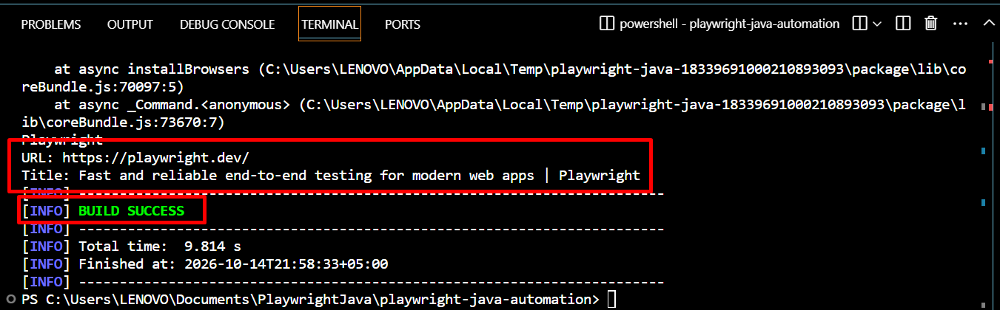

# Day 01 — Environment Setup

## 1. Learning Objectives

- Install and configure Java JDK 21.
- Set up Maven for project management and build automation.
- Configure Visual Studio Code for Java development.
- Set up Playwright for Java and run the first browser automation script.

## 2. What I Learned

- **Java JDK:** Learned about Java JDK 21 and its role in compiling and running Java applications.
- **Maven:** Learned how Maven manages project dependencies, compiles Java source code, and runs applications.
- **Playwright:** Learned how to initialize Playwright using `Playwright.create()` and launch Chromium.
- **Browser and Page:** Learned how to launch a browser, create a new page, navigate to a website, and retrieve its URL and title.

## 3. Practical Exercises

| Task | Expected Result | Actual Result | Status |
|---|---|---|---|
| Check Java version | JDK 21 detected | Maven compilation log confirmed Java release 21 | Completed |
| Check Maven version | Maven runs successfully | Maven successfully executed the project build command | Completed |
| Set up Maven project | Project structure created successfully | Created `playwright-java-automation` with `pom.xml`, `App.java`, and `AppTest.java` | Completed |
| Configure Playwright | Playwright dependencies available | Successfully compiled the Java application using Playwright | Completed |
| Run first Playwright script | Browser opens a website | Chromium opened the Playwright website successfully | Completed |
| Retrieve page information | URL and title displayed in the terminal | Retrieved page information using `page.url()` and `page.title()` | Completed |

## 4. Issues and Troubleshooting

- **Issue:** Compilation failed with an `illegal static interface method call` error.
- **Root cause:** The `Playwright.create()` static method was called using the variable name `playwright` instead of the class name `Playwright`.
- **Solution:** Changed `playwright.create()` to `Playwright.create()`.
- **What I learned:** Java is case-sensitive. Static methods should be called using the class name, and class names must be distinguished from variable names.

## 5. Evidence

- **Console output:** 

- **Related source files:**
  - `src/main/java/com/tester/App.java`
  - `src/test/java/com/tester/AppTest.java`
  - `pom.xml`
  - `README.md`

## 6. Daily Reflection

- **What I understood:** I understood the basic Maven project structure, the role of Java JDK, and how Playwright launches Chromium, navigates to a website, and retrieves page information.
- **What I still need to review:** Java syntax, Maven commands, Playwright locators, browser interactions, and assertions.
- **Plan for the next day:** Learn Playwright locators, practice interacting with web elements, and write basic automated checks.